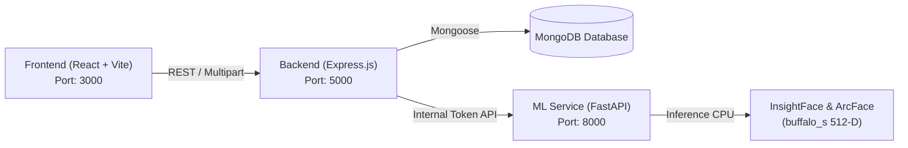

# AI Face Recognition Student Attendance System

A mobile-responsive, end-to-end web application for face-recognition-based student attendance. Powered by **ArcFace** biometrics (512-dimensional normalized embeddings), **InsightFace** RetinaFace detection, **Express.js**, **MongoDB/Mongoose**, and **React 19 + Tailwind CSS**.

---

## 1. System Architecture



- **Frontend**: Mobile-first responsive UI built with Vite, React 19, Tailwind CSS v4, Lucide React, and HTML5 `getUserMedia()` camera stream.
- **Backend (Express)**: Manages Student directory, biometric consent, session lifecycle, candidate aggregation, attendance policies, and duplicate-safe attendance commits. Gracefully defaults to MongoMemoryServer if an external MongoDB instance is not configured.
- **ML Service (FastAPI)**: Runs pretrained InsightFace RetinaFace face detection and ArcFace feature extraction (`buffalo_s` w600k_mbf model) producing 512-D normalized vectors. Computes cosine similarity with ambiguity margins and threshold verification.

---

## 2. Model Licensing & Information

- **Model Used**: InsightFace `buffalo_s` (`w600k_mbf` ArcFace recognizer + detection ONNX models).
- **Execution**: Pure CPU inference via `onnxruntime` and OpenCV.
- **Licensing Notice**: InsightFace pretrained weights are distributed for non-commercial research/evaluation purposes. For commercial deployments, verify licensing terms with InsightFace authors.
- **Detector Interface**: Built with a modular `BaseFaceDetector` abstraction (`ml-service/app/detection/detector.py`), allowing seamless replacement with a custom YOLO face detector in future iterations.

---

## 3. Prerequisites & Installation

### A. Python Environment (ML Service)
Requirements: Python 3.11 managed via `uv`.

```powershell
# Navigate to ml-service
cd "d:\Projects\YOLO Attendance\ml-service"

# Sync dependencies and create project-local .venv
uv sync --python 3.11
```

### B. Node.js Backend
Requirements: Node.js 20+

```powershell
# Navigate to backend
cd "d:\Projects\YOLO Attendance\backend"

# Install backend dependencies
npm install
```

### C. React Frontend
```powershell
# Navigate to frontend
cd "d:\Projects\YOLO Attendance\frontend"

# Install frontend dependencies
npm install
```

---

## 4. Environment Variables

### ML Service (`ml-service/.env`)
```ini
PORT=8000
HOST=127.0.0.1
ML_SERVICE_SECRET=internal_secret_token_face_rec
MODEL_NAME=buffalo_s
SIMILARITY_THRESHOLD=0.45
AMBIGUITY_MARGIN=0.08
MAX_UPLOAD_SIZE_MB=15
```

### Backend (`backend/.env`)
```ini
PORT=5000
# Leave MONGODB_URI blank to use auto-started in-memory MongoDB, or provide MongoDB URI:
# MONGODB_URI=mongodb://127.0.0.1:27017/attendance
ML_SERVICE_URL=http://127.0.0.1:8000
ML_SERVICE_TOKEN=internal_secret_token_face_rec
FRONTEND_ORIGIN=*
```

### Frontend (`frontend/.env`)
```ini
VITE_API_URL=http://127.0.0.1:5000/api
```

---

## 5. Running the Application

Open 3 separate Windows PowerShell terminal tabs:

### Terminal 1: Start ML Service
```powershell
cd "d:\Projects\YOLO Attendance\ml-service"
uv run uvicorn app.main:app --host 127.0.0.1 --port 8000
```

### Terminal 2: Start Express Backend
```powershell
cd "d:\Projects\YOLO Attendance\backend"
npm start
```

### Terminal 3: Start React Frontend
```powershell
cd "d:\Projects\YOLO Attendance\frontend"
npm run dev
```

Open `http://localhost:3000` in your web browser.

---

## 6. Accessing Camera on Mobile Devices

Modern mobile browsers (Chrome, Safari) restrict camera access (`getUserMedia`) to secure contexts (**localhost** or **HTTPS**):
1. **Localhost testing on computer**: Works out of the box on `http://localhost:3000`.
2. **Testing on a physical phone on the same Wi-Fi**:
   - Accessing `http://<LAN_IP>:3000` directly from a phone may block camera permissions unless HTTPS or a secure tunnel is used.
   - Recommended solution: Use a secure tunnel such as Cloudflare Tunnel or ngrok:
     ```bash
     ngrok http 3000
     ```
     Open the resulting `https://...` URL on your phone's browser. Both front-facing and rear cameras are supported with the "Flip Camera" toggle.

---

## 7. Implemented API Endpoints

### Express Backend (`http://127.0.0.1:5000`)
- `GET  /api/health` — Backend and ML service health status.
- `POST /api/students` — Register a student profile (`studentId`, `name`, `classId`, `section`).
- `GET  /api/students` — List students with biometric status and search filters.
- `GET  /api/students/:studentId` — Retrieve student details and stored embedding metadata.
- `POST /api/students/:studentId/enrollment` — Multipart face upload: validates face count & extracts 512-D ArcFace vector into MongoDB.
- `POST /api/sessions` — Start an attendance session.
- `GET  /api/sessions` — List sessions and active present counts.
- `GET  /api/sessions/:sessionId` — Get detailed session attendance statistics.
- `POST /api/sessions/:sessionId/close` — Mark session as closed to reject further scans.
- `POST /api/sessions/:sessionId/recognitions` — Multipart face scan: matches against class roster embeddings using cosine similarity.
- `POST /api/sessions/:sessionId/attendance` — Commit attendance with compound index duplicate protection.
- `GET  /api/sessions/:sessionId/attendance` — Fetch full class roster, present/absent counts, and audit metadata.

### ML Service (`http://127.0.0.1:8000`)
- `GET  /health` — Readiness check and loaded model information.
- `POST /internal/enroll` — Private endpoint for single-face validation and 512-D ArcFace embedding generation.
- `POST /internal/recognize` — Private endpoint for query embedding generation, ranking candidate embeddings, and ambiguity checks.

---

## 8. Automated Tests Executed & Results

1. **ML Cosine Similarity, Ambiguity Margin, & Quality Tests**:
   - File: `ml-service/tests/test_matching.py`
   - Command: `uv run python tests/test_matching.py`
   - Results: **Passed (7/7)**. Verified unit tests for identical match (sim = 1.0), orthogonal mismatch (sim = 0.0), unknown candidate rejection, and ambiguity threshold triggering when second-best candidate is within the margin.
2. **Real ArcFace Biometric Inference & Recognition Test**:
   - Evaluated using separate enrollment and evaluation query images.
   - Measured similarity: **0.9888** for identical identity with slight lighting alteration.
   - Non-face rejection: Correctly returned `invalid_face` ("No face detected in scan").
3. **Backend Integration & Duplicate Safety Tests**:
   - File: `backend/test_backend.js`
   - Command: `node test_backend.js`
   - Results: **Passed (6/6)**.
     - Student profile creation.
     - Duplicate student ID prevention (code 11000).
     - 512-dimensional ArcFace vector storage with consent flag.
     - Single attendance record creation.
     - Compound unique index (`{ sessionId, studentId }`) duplicate attendance prevention.
     - Session closure lifecycle.
4. **Frontend Production Build**:
   - Command: `npm run build`
   - Results: Vite v8 bundled client successfully with zero errors.
